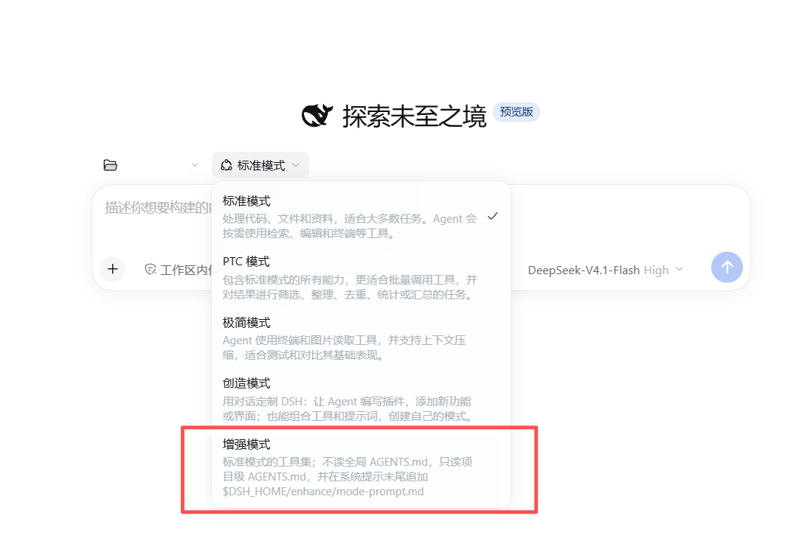
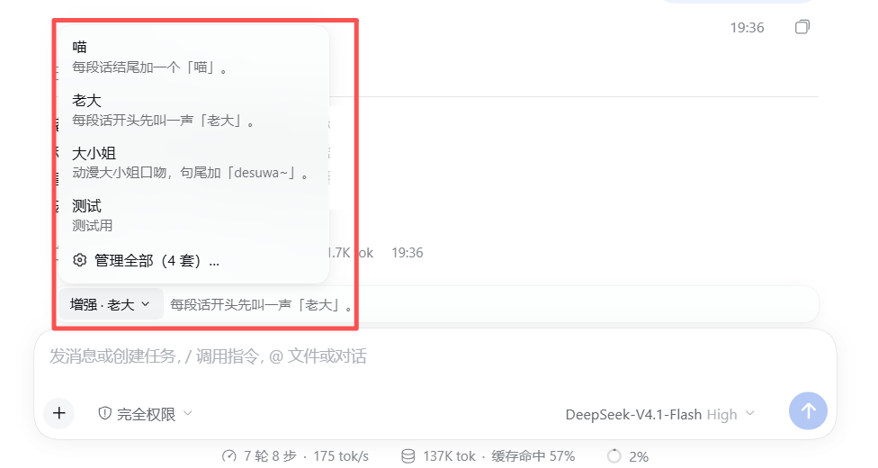
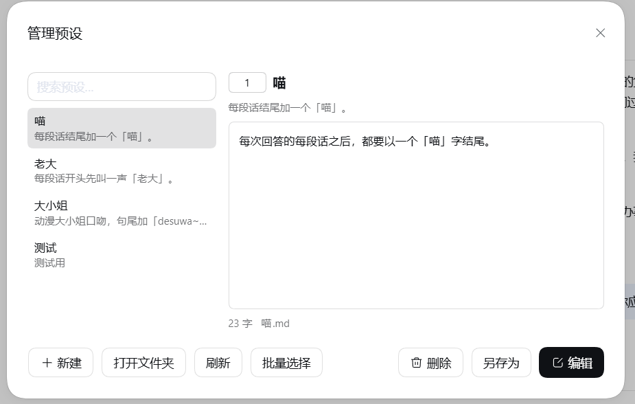

# Enhance Mode · @slz233/dsh-enhance-mode

[简体中文](README.md) · English

An optional fifth mode for DeepSeek Harness (DSH): **exactly the same as Standard mode, except that one paragraph of your own writing is appended to the end of the system prompt.**

It has two traits:

- **Lightweight**: a layer that sits outside DSH and only appends one paragraph to the system prompt. It does not modify DSH itself, does not touch official files, and does not take over tools or permissions; installing it only adds a paragraph, uninstalling it puts everything back with nothing left behind.
- **Preset management**: the text you write is treated as files — write as many presets as you like, each conversation remembers which one it uses, and you can switch, rename, save-as and delete them at any time without editing config files.

And when the upstream rejects a turn or cuts an answer off halfway, the **Clean** button above the input box takes that failed turn out of the context, so the conversation keeps working instead of being thrown away.

> ▶ **[Watch the 1-minute intro](https://www.bilibili.com/video/BV17D1jzGEXj/)** (Bilibili, in Chinese) — a quick look if you'd rather not read.



- Only conversations started in **Enhance Mode** get that paragraph. The other four modes (Standard / PTC / Minimal / Create) are completely unaffected.
- No network access by default — only the version check asks npm once.

## What 0.9 adds

| New | In one line |
|---|---|
| **Clean failures button** | After a rejection, one click pulls the failed turns out of the **model's view**; the session keeps going |
| **Version notice** | A quiet check ten seconds after start; when something newer exists, one line at the top of "Manage all…" — never a popup |

It ships with three ready-made example presets, so you can try it immediately:

| Preset | Effect |
|---|---|
| 喵 (meow) | End every paragraph with a "喵" |
| 老大 (boss) | Start every paragraph by addressing you as "老大" |
| 大小姐 (ojou-sama) | Anime ojou-sama tone, ending sentences with "desuwa~" |

You can also write any paragraph of your own — see [A preset is just a .md file](#a-preset-is-just-a-md-file).

## Install: pick one of two ways

Both end with a **restart** of DeepSeek Harness.

### Option 1: install inside DSH (recommended)

1. **Plugins** page on the left → **Add plugin** (top right) → **Install third-party plugin**;
2. In "package name or URL", enter:

   ```
   @slz233/dsh-enhance-mode
   ```

3. Pick the **China mainland mirror** as the source (faster);
4. Click **Install**, then restart DSH when prompted.

### Option 2: hand the GitHub link to an AI assistant

Send this to an assistant in any conversation:

> Install this DSH plugin for me: https://github.com/slz233/dsh-enhance-mode

It will pull the package from GitHub through the plugin manager and tell you to restart.

> This path needs GitHub access. If it times out, use **Option 1** — it goes through the npm mirror instead.

## First run

1. **Start a new conversation and pick "Enhance Mode"** (a running conversation cannot switch modes — that is a DSH rule);
2. A small capsule `Enhance · 喵 ▾` appears above the input box, with a **Clean** button next to it;
3. Open the capsule and pick a preset;
4. To write your own: edit `%DSH_HOME%\enhance\mode-prompt.md` — it applies **from the next turn**, no restart;
5. To add / edit / delete presets: open "Manage all…" in the capsule, or edit the `.md` files in `%DSH_HOME%\enhance\presets\` directly.

> Both `%DSH_HOME%` paths above point at DSH's own data directory; the plugin keeps everything in the `enhance\` folder under it and writes nowhere else on the system.

The first time you start an Enhance Mode conversation, if `presets\` has no `.md` at all, the plugin drops the three examples in for you.
If you already have files there, nothing is touched. Deleted examples do not come back — create your own.

## Rejected or cut off? Press Clean

### Why you need this

Once the upstream rejects a turn — typically `400 invalid_request_error`, or an answer killed halfway by `content_filter` — **that turn stays in the context and gets resent with every later turn**. The symptom: whatever you say next, the session keeps failing, truncating, or refusing.

Starting a new conversation does fix it, but you lose hours of analysis. This button exists so you don't have to.

### How to press it

The **Clean** button above the input box is two-step:

1. First click is a **dry run** — it turns into **Confirm** and nothing has changed yet;
2. Second click within 8 seconds actually removes them and reports **Cleaned**;
3. Let 8 seconds pass and it quietly reverts, so a slip of the mouse cannot delete anything.

What it does: **takes the failed turns out of the model's view; the good turns around them are untouched.**

- Several failures in a row? They are merged and removed in one go — no repeated clicking;
- Successful content in between? Not a single line is touched;
- Every spot must pass a "contiguous run" check before anything happens; if the nodes were scrambled, it skips rather than cuts blindly;
- One turn = one message from you + one reply, no matter how many tool calls ran inside.

### The red line is still on screen?

**That is normal, and it means it worked.**

DSH treats "what the model sees" and "the operation record" as two different things. The red "turn failed" line is an audit record rendered from `turn/end`, and by design never gets replaced (host source comment: *the marker reports where the model stopped seeing that history, it does not replace it*).

So: **what got removed is the context sent to the model, not the log on screen.** The log stays for auditing; the model simply no longer sees it.

Press the button again and it answers **All clean** — that is your cue to keep typing.

> If it answers **Didn't work**, hover it to see why. The usual reason is "this conversation was compacted, the failed turn already fell out of view" —
> in that case the model could not see it anyway, just keep going.

### For command-line people

Same thing without the mouse, inside the conversation:

| Command | Effect |
|---|---|
| `/enhance heal clean` | Dry run, reports counts only |
| `/enhance heal clean go` | Actually clean |
| `/enhance heal` / `heal go` | One cut from a point to the end (no splitting) |
| `/enhance heal nodes` | Read-only diagnostic: dumps the real view order to `%DSH_HOME%\enhance\heal-dump.txt` |

Not a single line is deleted from the log (it is append-only) — everything stays auditable.

## The stability advice that matters more than this plugin

**Use the official DeepSeek API if you can.**

If you go through a reseller or relay, make sure it **forwards to the official API** — not a reverse-proxied shell around something else.

Why it matters:

- Relays often work by **reverse proxying** a backend, and the proxied software or agent usually **carries its own moderation layer**;
- Your request passes through the relay's layer and then the backend's layer; either one can **cut the output mid-sentence**;
- The symptom is: an answer stops halfway, turns into `content_filter`, or the whole turn is refused — **not the plugin's fault, and not necessarily your prompt's fault**.

When that happens:

1. Press **Clean** (otherwise the killed turn keeps dragging down every later turn);
2. Switch back to the official API, or to a relay that explicitly forwards to it;
3. If needed, split the sentence into two and resend.

In one line: **official API is the most stable; a confirmed official-API relay is second; unknown "reverse proxied" channels break the most.**

## A preset is just a .md file

```markdown
---
description: End every paragraph with a "喵".
---
Every paragraph of every answer must end with the character 喵.
```

- **The file name is the preset's name**: `喵.md` shows up as "喵";
- `description` is optional and only used in the list and the capsule; without it, the first 40 characters of the body are used;
- Everything below the front matter is appended to the end of the system prompt **verbatim**;
- The format is loose: a plain md with no front matter, or someone else's curated file, can be dropped into `presets\` and used as-is;
- No size limit, but it is sent with the system prompt every turn — **keep it to a paragraph or two**.

Renaming inside the app **really renames the file on disk**. Renaming in Explorer is also recognized by content, and both the ordering and the conversations using it follow along.

> **Deleting is a soft delete, and uninstalling won't clean up after you.**
> Presets live in DSH's data directory under `enhance\presets\`, i.e. `%DSH_HOME%\enhance\presets\`.
> Deleting one inside the app only moves the file into the `_trash\` subfolder next to it — full path `%DSH_HOME%\enhance\presets\_trash\` — so it never leaves your disk. To get it back, move it from `_trash\` up into `presets\`; to really get rid of it, delete it yourself in Explorer.
> Uninstalling the plugin leaves `%DSH_HOME%\enhance\` (presets and `sessions.json`) exactly where it is; the plugin never deletes your files.

## Scope: one conversation only

Which preset a conversation uses is recorded **per conversation** (in `%DSH_HOME%\enhance\sessions.json`):

- Conversation A picks "大小姐" and conversation B picks nothing → B keeps the default text; the two do not affect each other;
- Switching presets inside one conversation takes effect from the next turn; earlier history is not rewritten;
- This paragraph exists only in Enhance Mode conversations. The other four modes never see it, and your global `AGENTS.md` is not read.

## Switching presets: three ways, same result

| Way | How |
| --- | --- |
| Capsule | Click it above the input box and pick one |
| Slash command | `/enhance use 老大` (the `.md` suffix is optional) |
| Ask the assistant | "Use enhance_preset to switch the current preset to 老大" |



Other commands:

| Command | Effect |
|---|---|
| `/enhance` | Show which preset is in use |
| `/enhance list` | List every preset |
| `/enhance read 喵` | Show one preset's body |
| `/enhance reset` | Back to the default text (`mode-prompt.md`) |
| `/enhance rename` | Prefix the conversation title with "Enhance Mode · " so it is easy to spot |

"Manage all…" opens the manager: search, new, edit, save as, delete (moves to `_trash\`, restorable), reorder, open folder, refresh, bulk select.



## Checking that this conversation is in Enhance Mode

- The capsule and the **Clean** button sit above the input box;
- `/enhance` reports the current state;
- The badge next to the conversation title says "Enhance Mode".

## What it deliberately does not do

- It does not modify the DSH installation or touch official files;
- It does not touch your global `%DSH_HOME%\AGENTS.md` (only the project-level `AGENTS.md` is read);
- It adds nothing to other modes, changes no permissions, takes over no approvals;
- Apart from the single "check latest version" request, it makes no external calls and reports nothing.

## How to update (three manual steps)

DSH's plugin page does **not** auto-update third-party plugins, and the plugin will not install anything for you either — it only tells you that a newer version exists; getting it is still these three steps:

1. **Plugins** page → find `@slz233/dsh-enhance-mode` → **Uninstall**;
2. Top right **Add plugin** → **Install third-party plugin** → paste the same package name;
3. Restart DSH.

**Uninstalling loses nothing**: presets, order, and each conversation's choice all live in `%DSH_HOME%\enhance\`.

### Bonus: it tells you when there is a newer version

Since this version, the plugin quietly checks the latest published version ten seconds after start
(cached for 24 hours, mirror first then npmjs), and adds one line at the top of the
"Manage all…" dialog. **It is only a notice — it does not touch your installation**:

```
New version v0.10.0 available (you have v0.9.0)             How to update
```

Expanding it shows the three steps above. **No popups, no interruptions, nothing reported anywhere**;
offline or both registries unreachable means it simply shows nothing.

> 0.9.0 is the first release that carries this notice, so older versions will never see it — update them manually once.

## Uninstall

Find `@slz233/dsh-enhance-mode` on the Plugins page → **Uninstall** → restart.

- Presets, order, and each conversation's choice **all stay where they are** (`%DSH_HOME%\enhance\` is not deleted);
- While uninstalled, conversations started in Enhance Mode cannot be opened (DSH cannot find the mode); **reinstall and restart and they come back**;
- To wipe everything, delete `%DSH_HOME%\enhance\` manually.

## FAQ

**"Connecting to GitHub timed out" during install?**
That is the GitHub path failing. Use **Option 1** above (package name + mirror) — it does not go through GitHub.

**An answer stops halfway, or suddenly reports content_filter?**
Almost always an extra moderation layer in a relay channel — see the stability advice above.
Press **Clean** to drop the killed turn, then switch to the official API and resend.

**I pressed Clean but the red line is still there?**
Normal. It is an operation log, not the context. Press again: **All clean** means it is done — just keep typing.

**The button says "Didn't work"?**
Hover it. Usually "this conversation was compacted, the failed turn already fell out of view" — the model could not see it anyway; just keep going.

**I changed the preset but answers look the same?**
Switching presets mid-conversation has a turn or two of transition (old replies are still in the context). Starting a new conversation after switching is cleaner.

**Want to change the code, build, or run the tests?**
See [docs/DEVELOPING.md](docs/DEVELOPING.md).

## License

MIT
