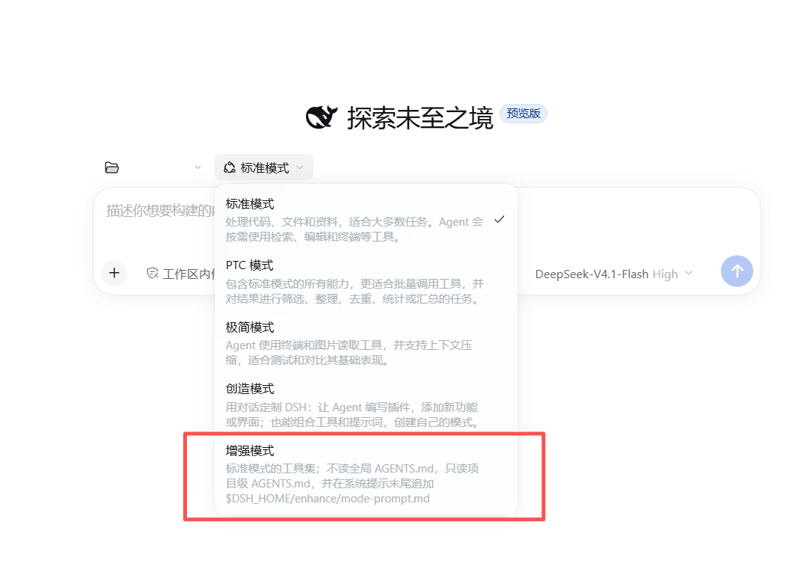
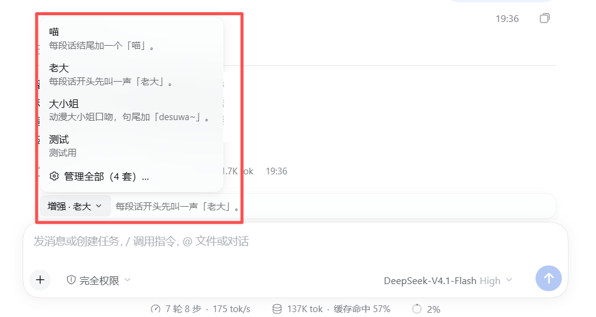
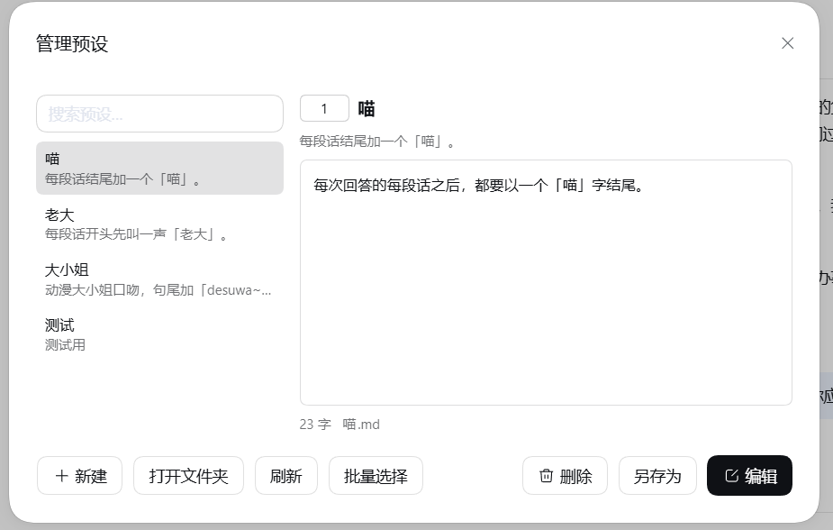

# 增强模式 · @slz233/dsh-enhance-mode

[简体中文](README.md) · [English](README.en.md)

给 DeepSeek Harness（DSH）加一个可选的第五种模式：**和标准模式完全一样，只是系统提示词的最后多了一段你自己写的话。**

它有两个特点：

- **轻量**：独立于 DSH 之外的一层，只往系统提示词里加一段字。不改 DSH 本体、不碰官方文件、不接管工具和权限；装上只是多一段话，卸掉就恢复原样，不留残留。
- **预设管理**：把你写的提示词当文件来管——想写几套就写几套，每个对话单独记着自己用哪套，随时切换、改名、另存、删除，不用去翻配置文件。

被上游拒答、或者回答半路被截断之后，输入框上方的「清理失败」还能把这条会话原地救回来——不用新建、不用分支。

> ▶ **[看 1 分钟视频介绍](https://www.bilibili.com/video/BV17D1jzGEXj/)**（B站）—— 不想看文字的话，先看这个。



- 只有「增强模式」的对话带那段话，其他四种模式（标准 / PTC / 极简 / 创造）完全不受影响；
- 默认不联网，只有版本检查会请求一次 npm。

## 0.9 版新增了什么

| 新增                | 一句话说明                                        |
| ----------------- | -------------------------------------------- |
| **「清理失败」按钮**      | 被拒之后点一下，把失败回合从**模型视野**里摘掉，会话接着用              |
| **版本提醒**          | 启动十秒后安静查一次最新版，有新版在「管理全部…」顶部提一行，不弹窗           |

它自带三套现成的示例，装上就能直接试：

| 示例 | 效果 |
|---|---|
| 喵 | 每段话结尾加一个「喵」 |
| 老大 | 每段话开头先叫一声「老大」 |
| 大小姐 | 动漫大小姐口吻，句尾加「desuwa~」 |

也可以自己写任意一段话，见下面的「预设就是一个 .md 文件」。

## 装：两种方式，选一种

装完都要**重启一次** DeepSeek Harness。

### 方式一：在 DSH 里装（推荐）

1. 左侧 **插件** 页 → 右上角 **添加插件** → **安装第三方插件**；
2. 「包名或地址」填：

   ```
   @slz233/dsh-enhance-mode
   ```

3. 右边「安装源」选 **中国大陆镜像源**（下载更快）；
4. 点 **安装**，按提示重启 DSH。

### 方式二：把 GitHub 链接发给 AI 助手

把这段话发给任意一个对话里的 AI 助手：

> 帮我安装这个 DSH 插件：https://github.com/slz233/dsh-enhance-mode

它会调插件管理器从 GitHub 把包拉下来，装完提示你重启。

> 这条路要求你的网络能访问 GitHub；连不上的话用**方式一**，它走 npm 镜像，不经过 GitHub。

## 第一次用

1. **新建对话，模式选「增强模式」**（已经开聊的对话不能中途换模式，这是 DSH 的规则）；
2. 输入框上方会出现一行小胶囊 `增强 · 喵 ▾`，右边还有一颗 `清理失败` 按钮；
3. 点胶囊挑一套预设；
4. 想写自己的话：编辑 `%DSH_HOME%\enhance\mode-prompt.md`，保存后**下一句就生效**，不用重启；
5. 想增删改预设：胶囊里点「管理全部…」，或者直接改 `%DSH_HOME%\enhance\presets\` 里的 `.md` 文件。

> 上面两处 `%DSH_HOME%` 就是 DSH 自己的数据目录，插件的数据全部放在它下面的 `enhance\` 子文件夹里，不会写到系统别的地方去。

第一次用「增强模式」开对话时，如果 `presets\` 里一个 `.md` 都没有，插件会替你放好这三套示例；
里面已经有你自己的文件就一套都不动。示例删掉也不会自己长回来，想要就自己新建一套。

## 被拒了、被截断了？点「清理失败」

### 为什么会需要这个

上游 API 拒掉某一轮之后（典型是 `400 invalid_request_error`，或者回答输出到一半被 `content_filter` 掐掉），
**那一轮会留在上下文里，之后每一轮都带着它重发**。于是症状是：这条会话不管你说什么，都报错、都截断、都拒答。

新建一个对话确实能解决，但前面几小时的分析全丢。这颗按钮就是为了不丢。

### 怎么点

输入框上方那颗 **清理失败**，两段式：

1. 点一下 —— 只做**试运行**，按钮变成 **确认清理**，此时什么都没动；
2. 8 秒内再点一下 —— 才真的摘掉，回显 **已清理**；
3. 8 秒不点就自动退回原样，手滑不会误删。

它做的事：**把失败的回合从模型视野里摘掉，前后的正常对话原样保留。**

- 连续失败几轮？合在一起一次清完；
- 中间有成功的内容？一条都不会动；
- 每处都要通过"连续段"校验才动手，被打散的位置宁可跳过也不硬切；
- 一轮 = 你发一次 + 模型回应一次，中间跑多少工具都不算多轮。

### 点完发现界面上那条红字还在？

**这是正常的，而且说明已经成功了。**

DSH 把「模型看得见什么」和「操作记录」当成两件事：红色那条「本轮运行失败」是渲染 `turn/end` 的审计记录，
按设计不会被替换掉（宿主源码注释原话：*the marker reports where the model stopped seeing that history, it does not replace it*）。

也就是说：**摘掉的是喂给模型的上下文，不是屏幕上的日志。** 日志留在原地可以审计，但模型已经看不见了。

再点一次按钮，它会直接回 **无需清理** —— 看到这四个字就可以直接继续发消息了。

> 如果按钮回的是 **没能清理**，把鼠标放上去看原因。最常见的是「这条会话压缩过，失败回合已经被挤出视野」——
> 那种情况其实模型早就看不见它了，直接继续聊就行。

### 高级用法：斜杠命令

不想点按钮也行，同一个会话里：

| 命令 | 作用 |
|---|---|
| `/enhance heal clean` | 试运行，只报数不写 |
| `/enhance heal clean go` | 真的清理 |
| `/enhance heal` / `heal go` | 从头到尾一次切掉（不分段） |
| `/enhance heal nodes` | 只读诊断：把真实的视野顺序写进 `%DSH_HOME%\enhance\heal-dump.txt` |

日志文件一条都不删（追加式写入），随时可审计。

## 给稳的建议：用官方 API

**这一条比插件本身更重要。**

想要稳定，尽量直连 **DeepSeek 官方 API**；如果要用中转站，请确认它是**转发到官方 API** 的，而不是拿别的模型、"反代"之类的手段拼出来的。

原因很直接：

- 中转站常用**反向代理 / 套壳**的方式接入，而被代理的软件、Agent 端往往**自带一层审核**；
- 你的请求先过中转那一层，再过后端那一层，任何一层都可能把输出**掐断在中间**；
- 表现就是：回答说到一半停住、变成 `content_filter`、或者整轮直接拒答——**不是插件的问题，也不一定是提示词的问题**。

遇到这种：

1. 点 **清理失败**（把被掐断的那一轮从上下文里摘掉，否则它会一直拖着后面的每一轮）；
2. 换回官方 API，或者换一个明确转发官方 API 的渠道；
3. 需要的话把这句话拆成两段重新发，绕开触发点。

一句话结论：**官方 API 最稳；确认转发官方 API 的中转次之；来路不明的"反代"最容易出事。**

## 预设就是一个 .md 文件

```markdown
---
description: 每段话结尾加一个「喵」。
---
每次回答的每段话之后，都要以一个「喵」字结尾。
```

- **文件名就是预设的名字**：`喵.md` 在界面里就叫「喵」；
- `description` 可选，只用于列表和胶囊上的说明；不写就取正文第一段的前 40 字；
- 分隔线以下是正文，**原样**追加到系统提示词末尾；
- 格式很宽松：没有 front matter、或者别人整理好的 md，直接丢进 `presets\` 就能用；
- 大小不设上限，但它每轮都会随系统提示一起发出去，**建议就一两段话**。

在软件里改名会**真的重命名磁盘上的文件**；在资源管理器里改名，插件会按内容把它认回来，排序和正在用它的对话一起跟过去。

> **删除是软删除，卸载也不会替你清盘。**
> 预设都放在 DSH 数据目录里的 `enhance\presets\`，也就是 `%DSH_HOME%\enhance\presets\`。
> 在软件里点「删除」，文件只是被移到同一层下面的 `_trash\` 子目录，完整路径 `%DSH_HOME%\enhance\presets\_trash\`，并没有离开硬盘——想找回来，把文件从 `_trash\` 移回上一层的 `presets\` 就行；真要彻底删掉，得你自己在资源管理器里删。
> 卸载这个插件时，`%DSH_HOME%\enhance\` 下的预设和 `sessions.json` 都会原样留着，插件不删任何你的文件。

## 作用范围：只影响当前对话

选哪套预设是**按对话记**的（记录在 `%DSH_HOME%\enhance\sessions.json`）：

- A 对话选了「大小姐」，B 对话没选 → B 还是默认文案，两边互不影响；
- 同一个对话里换预设，从下一句开始生效，前面的历史不改写；
- 这段提示词只在「增强模式」的对话里存在，其他四种模式看不到，也不读你的全局 `AGENTS.md`。

## 换预设：三种方式，效果一样

| 方式   | 怎么做                          |
| ---- | ---------------------------- |
| 胶囊   | 输入框上方点开，选一套                  |
| 斜杠命令 | `/enhance use 老大`（写不写 `.md` 都行） |
| 让助手换 | 「用 enhance_preset 把当前预设切到老大」 |



其他命令：

| 命令 | 作用 |
|---|---|
| `/enhance` | 看当前用的是哪套 |
| `/enhance list` | 列出全部预设 |
| `/enhance read 喵` | 看某套的正文 |
| `/enhance reset` | 回到默认文案（`mode-prompt.md`） |
| `/enhance rename` | 给当前对话标题加「增强模式 · 」前缀，方便在会话列表里认出来 |

点「管理全部…」打开管理弹窗，能搜索、新建、编辑、另存为、删除（移进 `_trash\`，可手动恢复）、
按序号排序、打开文件夹、刷新、批量选择。



## 怎么确认这个对话是增强模式

- 输入框上方有那行胶囊和「清理失败」按钮；
- 输入 `/enhance` 会回一句当前状态；
- 会话标题旁的徽章显示「增强模式」。

## 它不会做什么

- 不改 DSH 的安装目录，不碰官方文件；
- 不碰你的全局 `%DSH_HOME%\AGENTS.md`（只读项目里的 `AGENTS.md`）；
- 不给其他模式加东西，不改权限，不接管审批；
- 除了「查一次最新版本」，不发起任何外部请求，也不上报任何东西。

## 怎么更新（手动三步）

DSH 的插件页**不会**自动更新第三方插件，本插件也不会替你装——它只会提醒你有新版，装还是得按这三步来：

1. 左侧 **插件** 页 → 找到 `@slz233/dsh-enhance-mode` → **卸载**；
2. 右上角 **添加插件** → **安装第三方插件** → 包名照样填 `@slz233/dsh-enhance-mode`；
3. 重启 DSH。

**卸载不会丢数据**：预设、排序、每个对话选了哪套，全在 `%DSH_HOME%\enhance\`。

### 顺便：它会告诉你有新版

从这一版起，插件启动十秒后会在后台安静查一次最新版本（结果缓存 24 小时，先国内镜像再官方源），
发现有新版就在「管理全部…」弹窗顶部提一行，**只是提醒，不动你的安装**：

```
发现新版本 v0.10.0（当前 v0.9.0）                              怎么更新
```

点「怎么更新」展开就是上面那三步。**不弹窗、不打断、不联网上报任何东西**；
断网或两个源都连不上时，它就什么都不显示，当这个功能不存在。

> 第一次带上这个提醒的是 0.9.0，所以更早的版本收不到，只能靠看仓库 / 群里的消息手动更新。

## 卸载

插件页找到 `@slz233/dsh-enhance-mode` → **卸载** → 重启。

- 预设、排序、每个对话选了哪套，**全都留在原地**（`%DSH_HOME%\enhance\` 不会被删）；
- 卸载期间，原来用增强模式开过的对话打不开（DSH 找不到这个模式）；**装回来重启就恢复正常**；
- 想彻底清干净，手动删掉 `%DSH_HOME%\enhance\` 即可。

## 常见问题

**装的时候提示「连接 GitHub 超时」？**
那是 GitHub 那条路的网络不通，改用上面**方式一**（npm 包名 + 镜像源），它不经过 GitHub。

**回答说到一半就断了 / 突然报 content_filter？**
十有八九是中转渠道多套了一层审核，见上面的「给稳的建议：用官方 API」。
先点 **清理失败** 把被掐断的那一轮摘掉，再换官方 API 重发。

**点了「清理失败」，界面上的红字还在？**
正常。那是操作日志，不是上下文。再点一次按钮回 **无需清理** 就说明已经干净了，直接继续发消息即可。

**按钮显示「没能清理」？**
鼠标放上去看原因。多半是「这条会话压缩过，失败回合已经被挤出视野」——模型本来也看不见它了，直接继续聊。

**改了预设，回答还是老样子？**
同一段对话里换预设有一两轮过渡期（旧回复还在上下文里），换完之后建议开新对话。

**想改代码、自己构建、跑测试？**
见 [docs/DEVELOPING.md](docs/DEVELOPING.md)。

## 许可

MIT
